# Folevi for Mac: UI and function audit, 2026-11-18

Asked by the owner after 1.4.47: "there are still a lot of small UI issues, the spacing is uneven, text is pushing
too far left to the hover effect". Scope: the whole Mac app, on a scratch library (never the owner's library,
account or Keychain). Branch `mac-ui-audit`, from `main` at 1.4.47. Not released.

## How it was checked

- Every screen of the native frame, light and dark, as real window captures (`screens.mjs --look`): 47 screens,
  167 pictures, before and after. Popovers, menus, right-click menus, the Tab Overview, the smallest window.
- The note page (the one web part) with each panel and dialog open, with two automatic checks that must answer
  nothing: `hover-lint.js` (words against the edge of their own hover) and `font-lint.js` (interface text that isn't
  the system font).
- Functions on the scratch library: folders (create, nest, rename, colour, move, delete), notes (create, move,
  bookmark, duplicate, archive, trash, restore), tasks (create with a date and priority, complete, lists), tags,
  Foli AI on the stand-in model, the editor (bold, to-do, heading, card, page width, separator, colours, insert).
  All 35 steps pass (23 on the library, 12 in the editor; the script's Heading step looked for the wrong tag and was
  checked by hand: the line becomes a heading and goes back).
- Tests: 1,810 web unit tests, 209 Mac frame Swift tests, type-check and lint.

## What was wrong and is fixed

### The Style panel: rows no longer sit against their hover, even spacing, and the panel sits beside the note

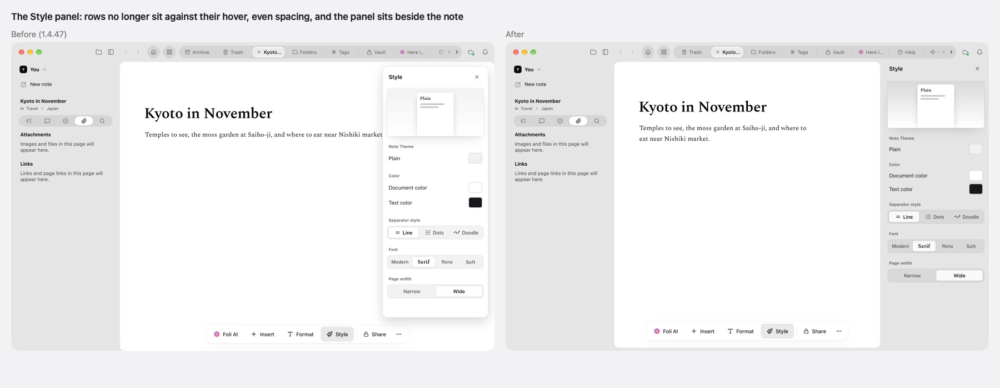

### A note at a 1280 pt window: the panel covered the note's words, now it sits beside it

### The Format panel: Page and Card now look and behave like every other tile

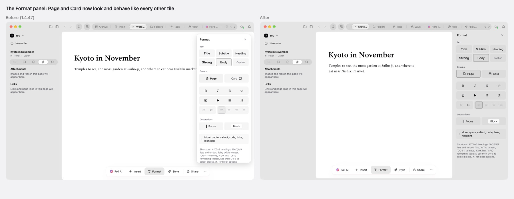

### The first time tabs overflow: the open tab was hidden under the arrows

### Add to the Vault: every field one height

### Help: no second title, the Mac's button shape, the right New note shortcut

### Move folder: every row's name on one line

### Note theme: Done and Use your own image are capsules, as in native dialogs

### The smallest window: the tools' title in the system font

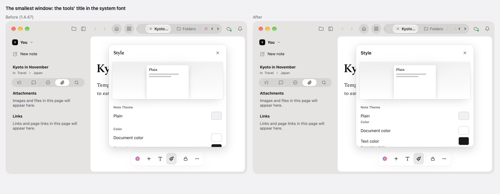

## Form fields (second pass, the owner: "form fields look tiny and weird")

The system's rounded field came out 22 to 28 pt tall depending on where it sat, and on a dark surface it had no
edge, so a dialog's fields read as thin slabs. Every text field of the native look is now one field (`NativeField`:
32 pt, a surface and a hairline edge in both themes, a ring while it has the cursor): the Vault's dialogs, New
folder and Rename, the Tasks filter and the add-task and event dialogs, and Settings' fields. The Vault dialog's
Kind menu sits on the same surface.

### Form fields: one proper field everywhere (32 pt, a visible edge, a clear focus ring), here in Add to the Vault

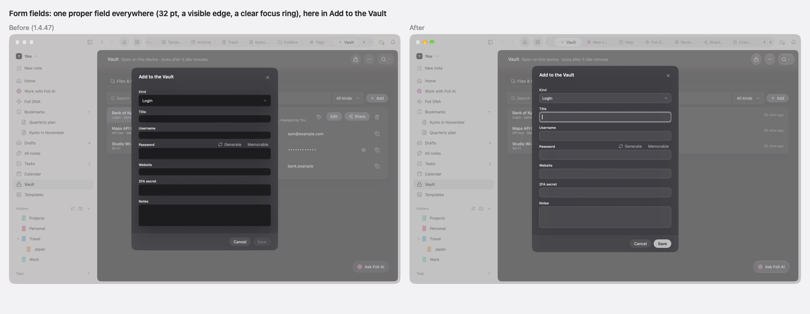

### The same dialog with the Mac in dark mode

### The Tasks filter field

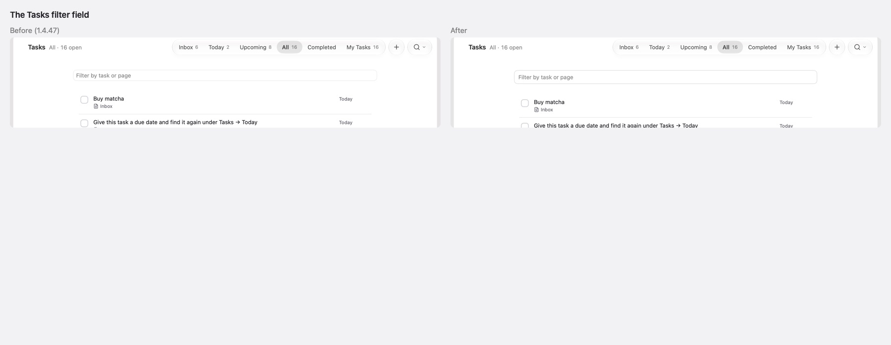

### Rename folder

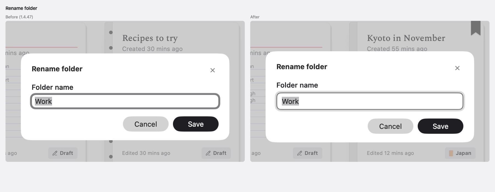

Not pictured: Settings' own fields (a key, a passphrase) open from buttons in the Settings window, which the test
tools can't click. They use the same field.

## The Theme picker (third pass, the owner: "show thumbnails/previews, full width")

Settings > Appearance > Theme was a small segmented control at the card's left. It is now three tiles across the
card, each a small picture of Folevi's window in that theme (System is the two halves side by side), with the
chosen one ringed in the accent and checked. `ThemeTiles.swift`.

### Settings > Appearance: the theme is chosen from three pictures of the window, across the card

### The same in dark mode

Not checked by a click: the test tools can't click inside the Settings window. The tiles call the same function
the segmented control did.

## Menus (fourth pass, the owner: the note's menu is "pure white", other menus "too compressed")

The owner chose: Liquid Glass for the note's menus, floating bar and popovers; the real macOS menu elsewhere with
taller rows and icons; 32 pt rows everywhere.

### The note's menu and floating bar: Liquid Glass, not flat white

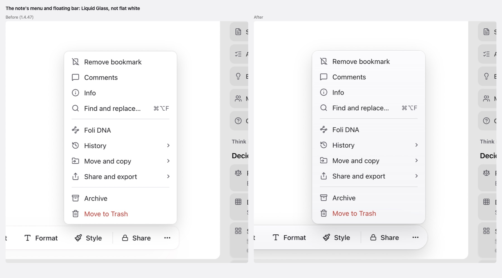

### The same in dark mode

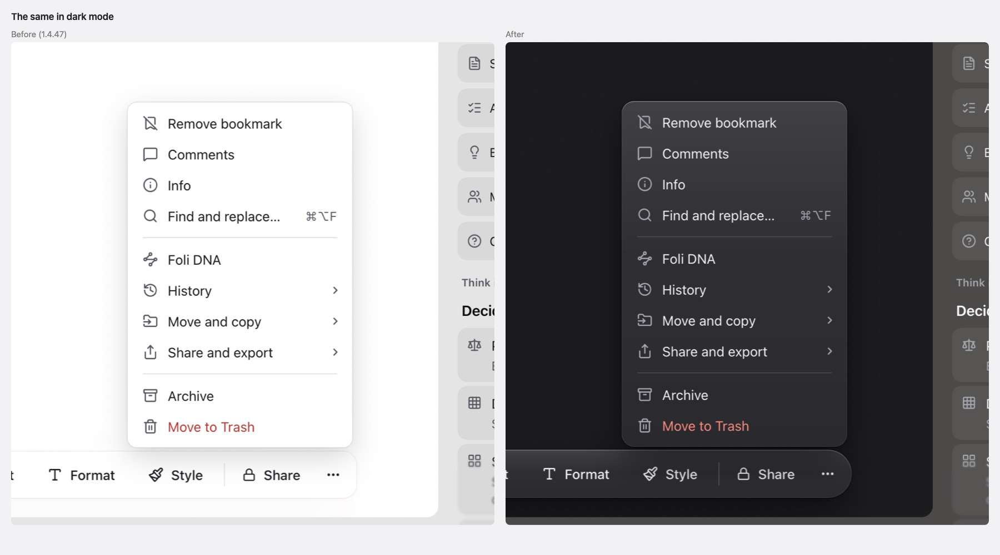

### A note card's right-click menu: 32 pt rows with icons (was 24 pt, no icons)

### A tab's right-click menu

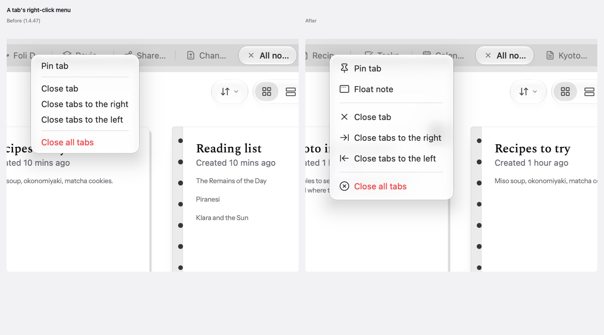

### The account menu

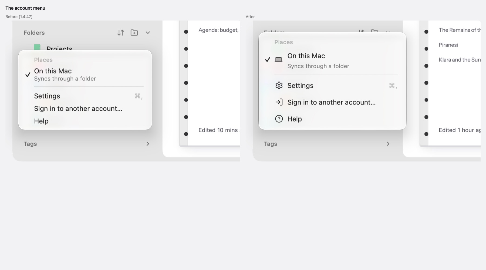

Not pictured: a row lit under the pointer (the test tools can't move the pointer over a system menu).

## Segmented controls (fifth pass, the owner: "settle on one design", the pill)

The note's left tools were pills 30 pt tall; the right panel's tabs and choices were rounded rectangles 36 to 40
pt tall. Every segmented control of the native look is now the pill at one size: a 34 pt track, a 28 pt pill.
Twelve Mac reference pictures of Foli DNA were recorded again for its Map / List pill (the iPad's and iPhone's
are unchanged).

### One segmented design, the pill: the left tools and the right panel's tabs now match, at one height

### The same in dark mode

### The Style panel's choices

## Shadows and the Vault (sixth pass, the owner: "I prefer less shadows ... especially in the Vault")

Every shadow had its own numbers (5% to 25% of black, 1 to 28 pt). There is now one scale of four light levels,
used by the native side and the note page alike, and the web's own drawn shadows are kept at half strength. The
Vault's tabs and view switch are pills, its Settings are grouped cards, and its sections have clearer spacing.

### Vault settings: named groups of rows in cards, pill tabs

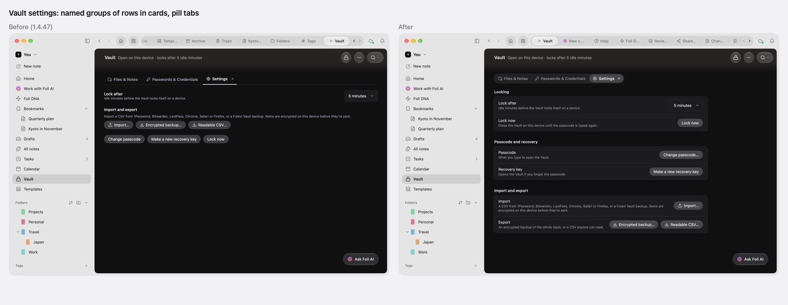

### Vault files: pill tabs and view switch, no repeated heading

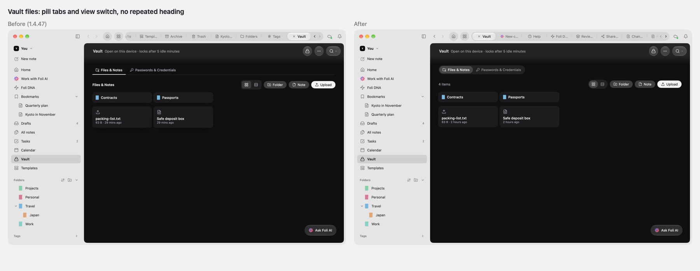

### Vault health: clearer steps between groups

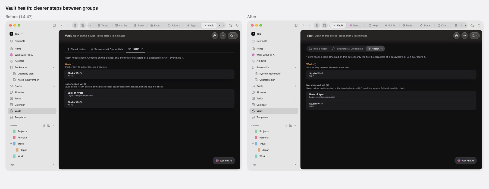

### A dialog's shadow: lighter, on the same scale as every other overlay

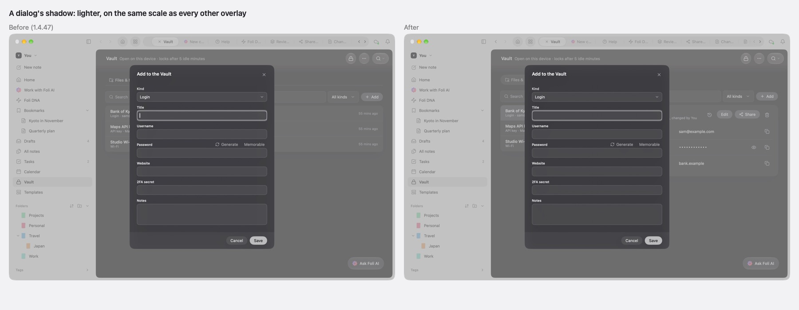

### Note cards: half the lift

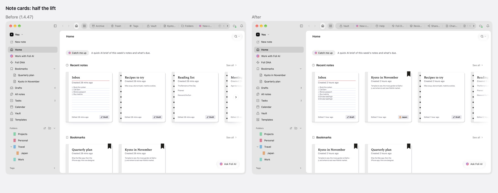

## Add to the Vault, redesigned (seventh pass, the owner: "very poorly done ... vastly improve this")

The dialog's shell, its fields and its active state were rebuilt: a plain panel with a title and a line saying what
it is for; labelled 34 pt fields 16 pt apart with a hover edge and an unmistakable active state; the Kind menu as a
field with its icon; the password's strength (four bars and a word) and Generate / Memorable under the field; the
actions on a band behind a hairline. Checked by typing into it: empty, active, filled, in both themes.

### Add to the Vault, redesigned: a clear active field, labelled 34 pt fields, the password's strength and tools under it

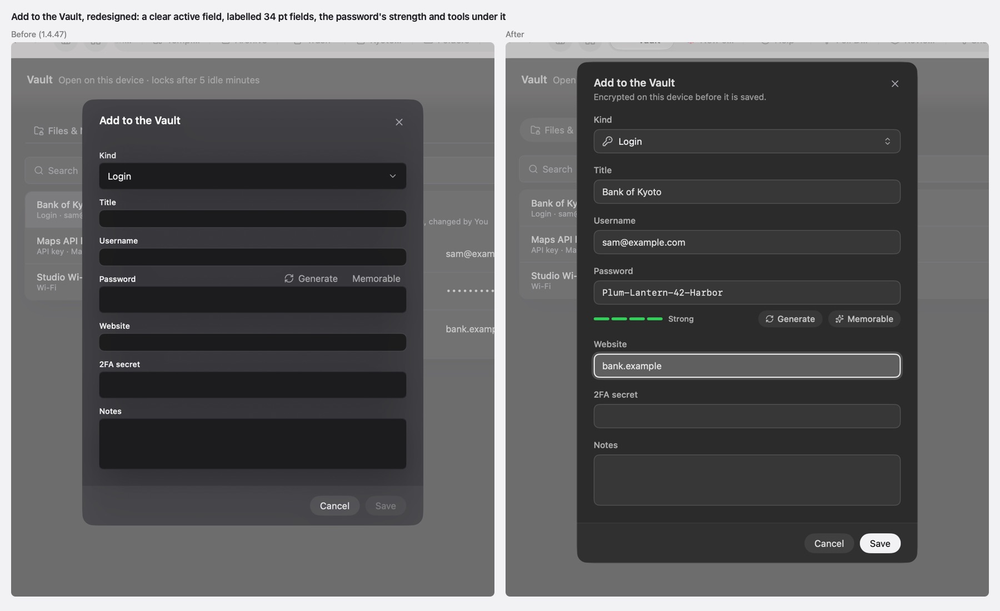

### The same on a Mac in dark mode (the Vault is the light one there)

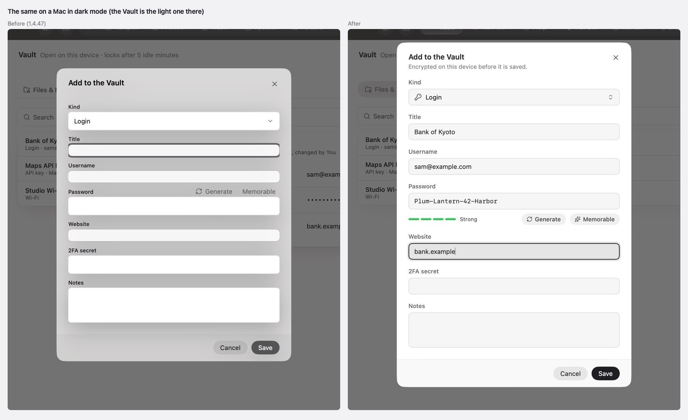

### Just opened: the cursor in Title

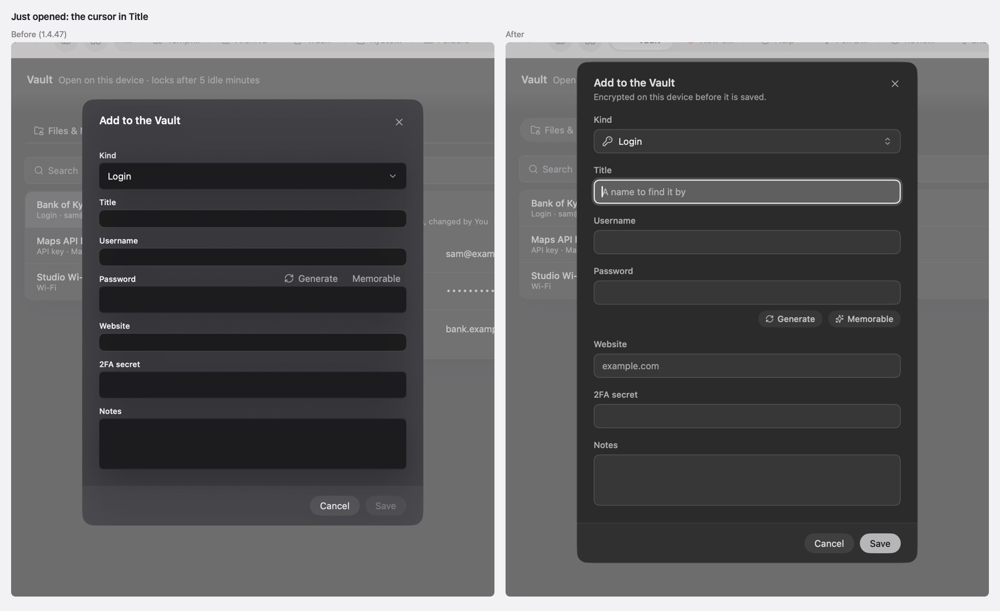

## Vault settings, redesigned (eighth pass, the owner: "need vast UI improvement")

A status header says what the Vault is doing now (open here, when it locks itself) with Lock now beside it. Under
it, named groups of rows: each row has its icon in a small tile, its name, a line about it and one control. Export
is two rows (an encrypted backup, a readable CSV with a plain warning) instead of two buttons in a line. The Lock
after menu is the form's pop-up field.

### Vault settings: a status header with Lock now, then named groups of rows, each with its icon, its words and its control

### The same on a Mac in dark mode (the Vault is the light one there)

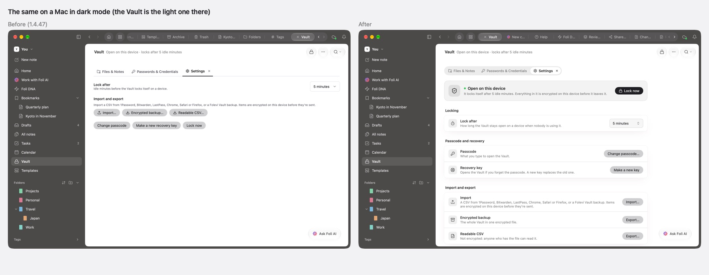

Also fixed, without a picture: the Import card in Settings had more padding under its buttons than above them; the
Vault's Add dialog took its height from whichever window was key, so it cut off its Notes field when Settings was
open or the app was behind another.

## Tasks and the Calendar (ninth pass, 2026-11-19, the owner: "polish Tasks and Calendar next")

Every Tasks view, the Calendar's three layouts, the task dialogs, the task menu and the Calendars popover, light
and dark, then the dialogs driven with clicks and keys on the scratch library. Three of the findings were faults,
not polish:

- **The task dialogs had no panel.** Edit task, Move task, Quick add and Subscribe were drawn over the window by
  the planner's own presenter, which on the Mac leaves the surface to the system's sheet. There was no sheet, so
  their titles and fields sat straight on the task list. They are now the frame's sheet, as every other dialog.
- **A done task's box was invisible** in Completed, in the Calendar's day list and in the Agenda: its only fill is
  a gradient and the native look drops gradients. It keeps a flat fill now.
- **The list of times was see-through**: the dialog's controls showed between the times.

The rest is polish: one kind of control in the task dialogs (pop-up buttons, a date button, a time button, the
form's labels), a magnifier in the filter, the facts under a task evenly spaced, separators from the words, day
headings alike in Upcoming and Agenda (only Overdue in the warning colour), a month that fits the window with its
side list scrolling on its own, a quieter "Schedule for today", and the calendar's colour as a row of dots.

### Edit task: it had no panel behind it, so its fields sat on the task list. Now the same sheet as every other dialog, with one kind of control

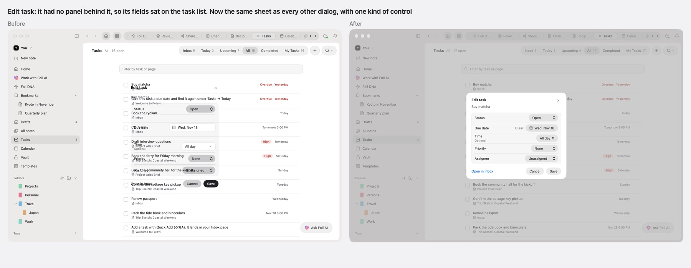

### Quick add task: the same fault and the same fix, with the form's own labels and pop-up button

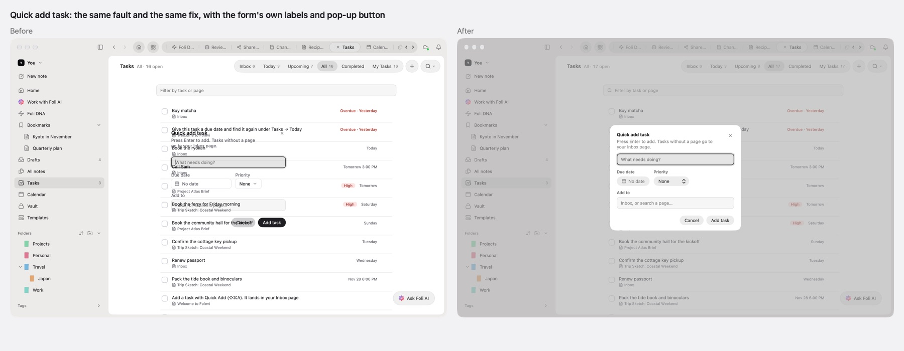

### Edit task in dark mode

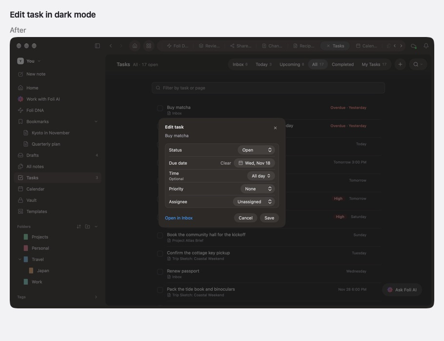

### Completed: a done task's box was invisible. It shows now, the facts under a title are evenly spaced, and the filter has its magnifier

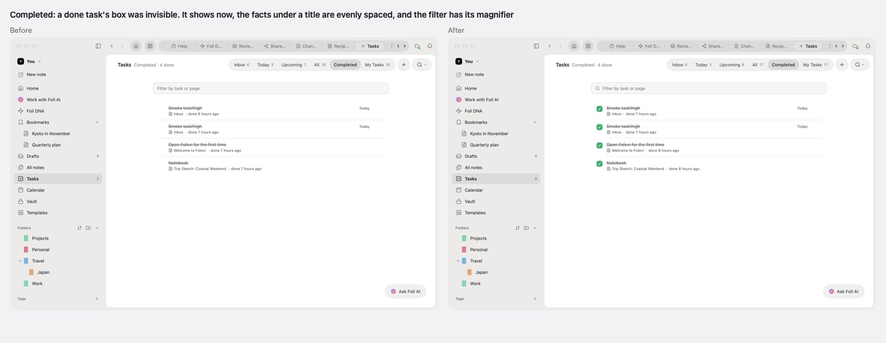

### Upcoming: separators start at the words, a day's heading sits on the boxes' edge

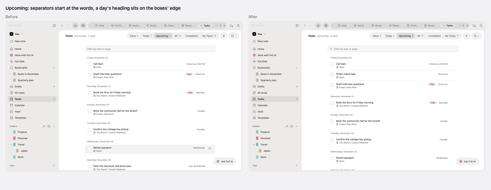

### The month: its card ran on empty under the last week, and the whole page scrolled as one. Now the weeks fit the window and the side list scrolls on its own

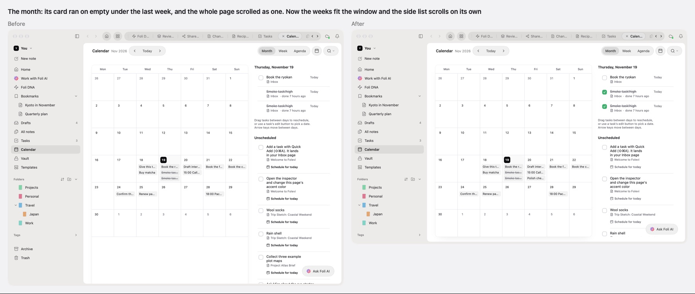

### The month in dark mode

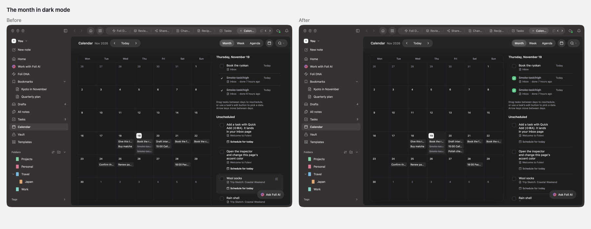

### Agenda: every day's heading was in the warning colour. Now only Overdue is

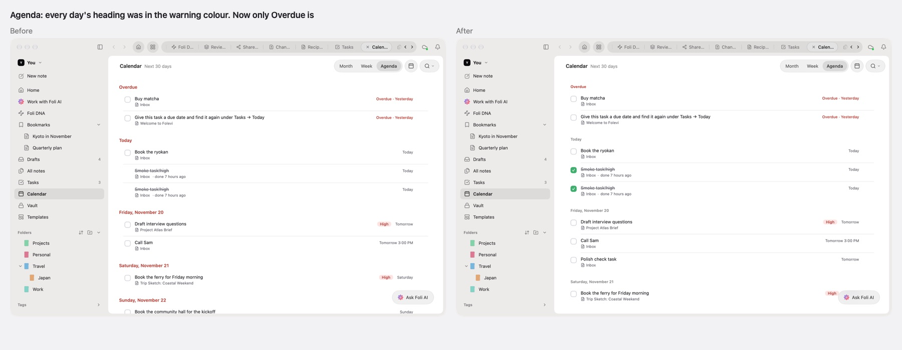

### Calendars: the six colours in one row of dots (the named chips wrapped, with Gray alone on a second row)

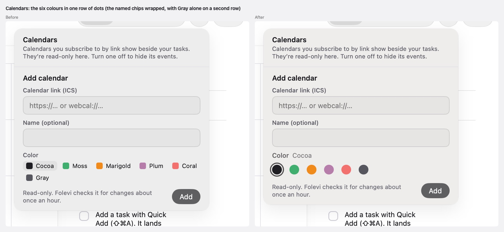

### The list of times: it was see-through over the dialog. Now it has a surface

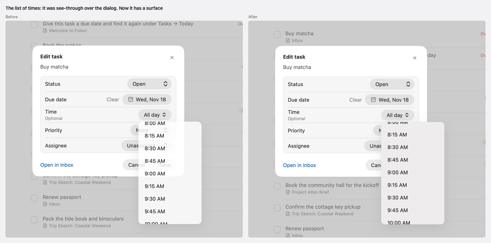

Checked by hand in the running app: the date's calendar and the list of times open from the sheet and Escape
closes only them, then the sheet; Clear removes the date and the Time row and the sheet resizes; Quick add reads
"tomorrow" in the task's words, adds the task and says so; Edit task saves with Return ("Task updated"); Move
task finds a page by its name and moves the task ("Task moved to Inbox"). Tests: 221 Mac frame tests (5 new in
`PlannerPolishTests`), the whole Swift package (iPad and iPhone pictures unchanged), and the shared code compiled
for iPad.

Not checked in this pass: Subscribe (it needs an account; it uses the same sheet), the default button's accent (the
test app is never the active app, so Save is drawn in the inactive colour in these pictures), dragging a task onto
a day, and events from a subscribed calendar.

## The tab's close button and the panel's foot (tenth pass, 2026-11-19, after 1.4.49)

Two notes from the owner on 1.4.49.

### A tab's close button: it sat beside the title, so it moved with the tab's width. Now it is at the tab's left edge in every tab

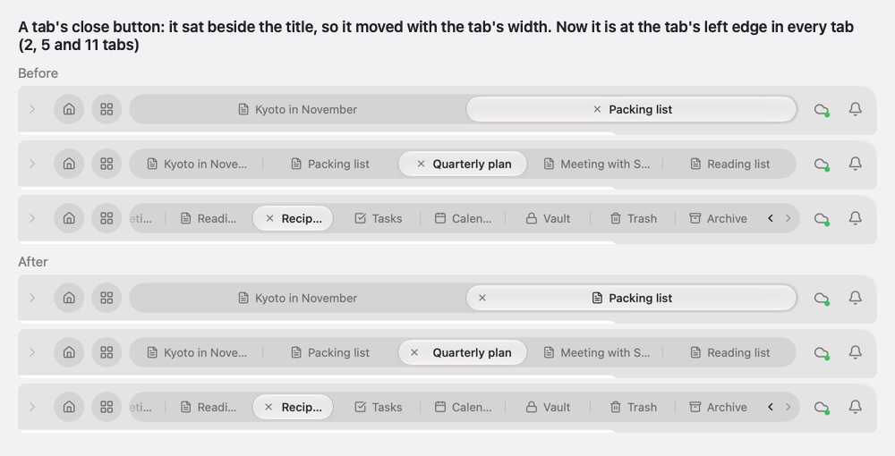

The × took the icon's place, and the icon and title are centred in the tab, so in a wide tab the × floated in the
middle. It is now an overlay at the tab's leading edge (`TabCloseSpot`). In a wide tab the icon stays beside the
title; in a narrower one the × shows in the icon's stead and the title doesn't move.

### Foli AI's panel: the blur over its last rows is gone, in light and dark

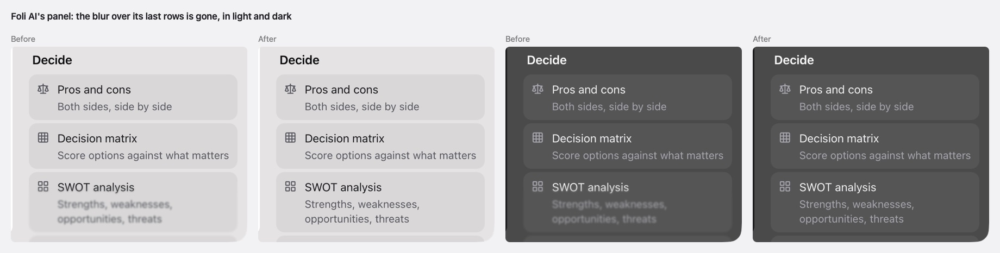

The web's sidebar blurs its last rows into the bottom edge. In Folevi for Mac the panel now runs clear to the
window's edge in every tab, as Insert, Format and Style already did. The owner had the web drop its blur the same
day, so the panel runs clear to the edge there too.

Tests: `TabCloseSpotTests` (4) and one more in `note-panels-polish.test.ts`. Not pictured: the × under the pointer
on a tab that isn't open (the pointer can't be moved for the test app alone); it is the same button in the same
place.

## Tasks without lines (2026-11-19)

The owner: "Keep the spacing but remove the horizontal lines here." The lines between tasks are gone in every list
of tasks (Tasks' views, the Calendar's day list and Agenda); the rows are where they were.

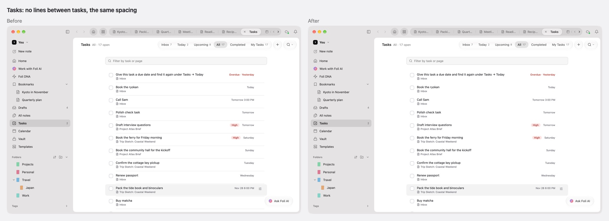

Then the owner agreed to the same in the other lists of one kind of row: notes and folders in list view, the
account lists (Shared with Me, Changes), the Vault's lists, the calendars in the Calendars popover and Help's
shortcuts.

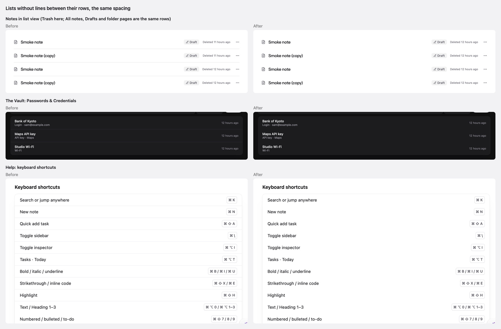

Not pictured: folders in list view (the same gap as the notes list), the account lists and the Calendars popover's
rows (both need a signed-in account; the scratch library has none). With no line to hide beside a highlighted
row, the notes list's page no longer tracks which row the pointer is on, which had made every built row again at
each crossing.

The same day's performance pass is in `docs/MAC_PERFORMANCE_2026-11-19.md`.

## Not covered, and why

- **Hover states of the native parts** (sidebar rows, cards, tabs) could not be pictured: moving the pointer for
  the test app alone isn't possible, and taking over the Mac's pointer wasn't acceptable while the owner worked.
  Web hovers (the note page) are measured by `hover-lint.js`.
- **Sync, sharing, comments, sign-in and real Foli AI answers** were not run. The scratch library is local, and
  no dev test account was signed in during this pass. They are covered only by the existing tests.
- **Drag and drop, printing, Quick Add from another app, Touch ID, updates** were not exercised.
- Twice the test window became screen-sized by itself during scripted runs. It didn't happen again in a dozen
  tries, and the existing scripts already work round it ("the size again for every screen"). Not found.

The rules these fixes follow are in `docs/MAC_NATIVE_LOOK.md` ("The note page follows the same rules").
