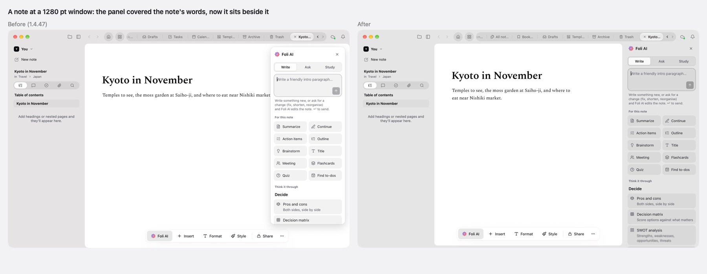
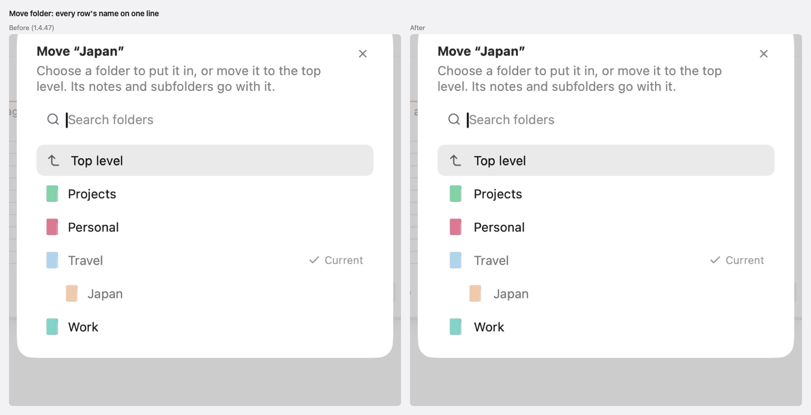
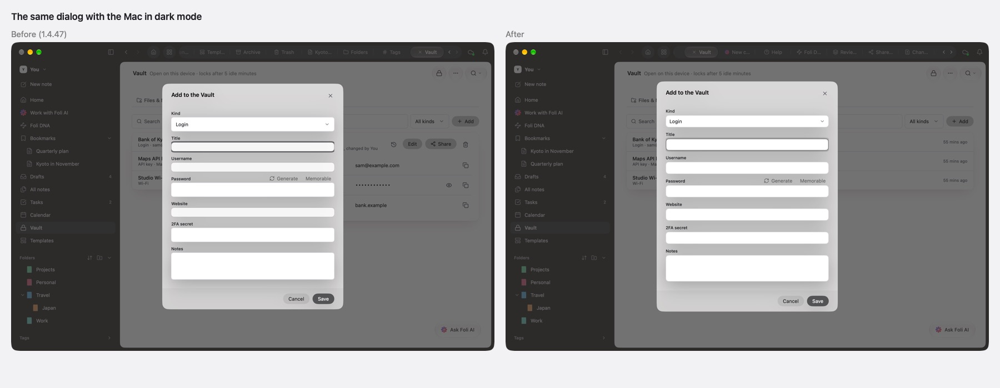
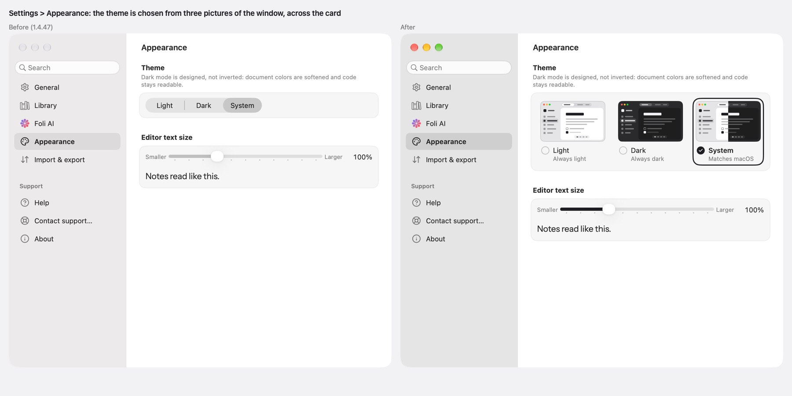
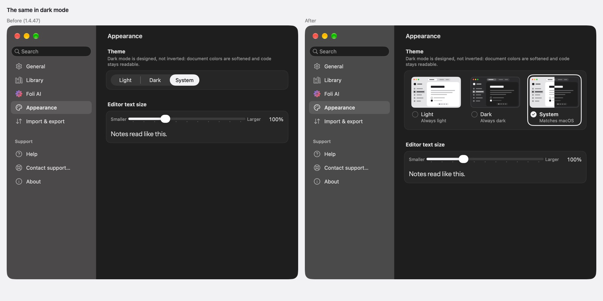
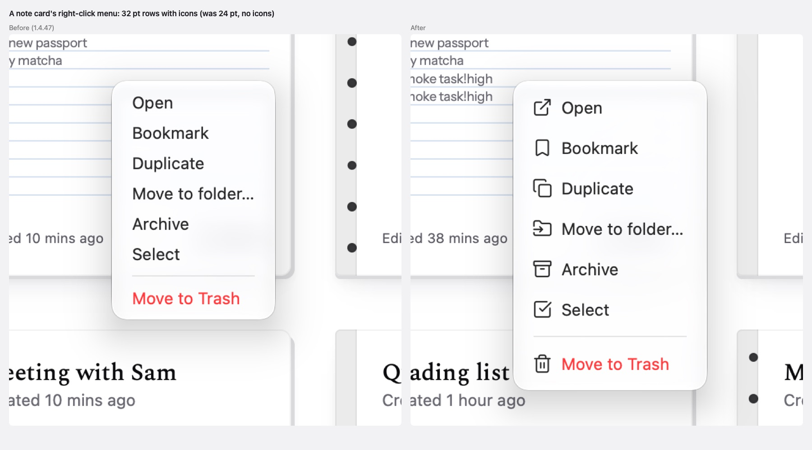
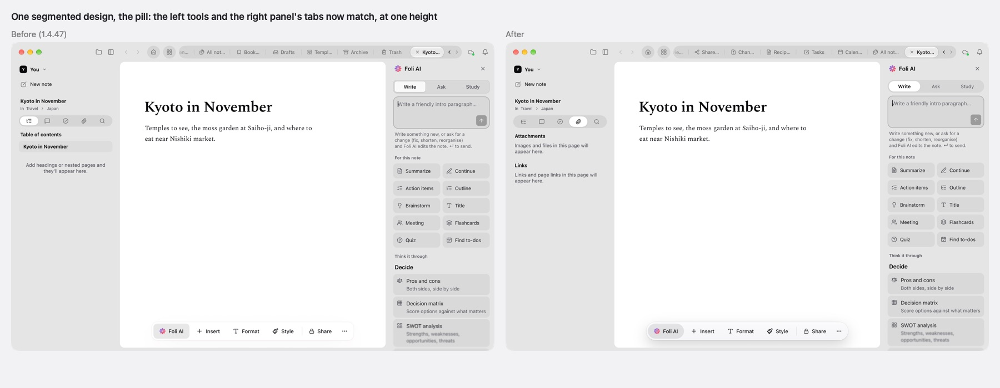
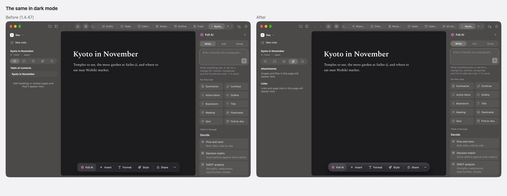
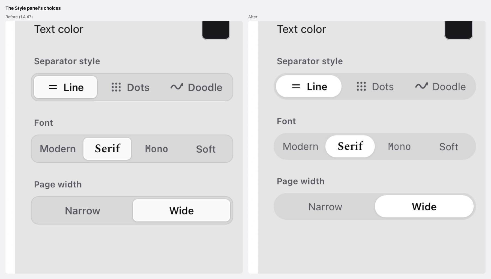

# Folevi for Mac: UI and function audit, 2026-11-18

Asked by the owner after 1.4.47: "there are still a lot of small UI issues, the spacing is uneven, text is pushing
too far left to the hover effect". Scope: the whole Mac app, on a scratch library (never the owner's library,
account or Keychain). Branch `mac-ui-audit`, from `main` at 1.4.47. Not released.

## How it was checked

- Every screen of the native frame, light and dark, as real window captures (`screens.mjs --look`): 47 screens,
  167 pictures, before and after. Popovers, menus, right-click menus, the Tab Overview, the smallest window.
- The note page (the one web part) with each panel and dialog open, with two automatic checks that must answer
  nothing: `hover-lint.js` (words against the edge of their own hover) and `font-lint.js` (interface text that isn't
  the system font).
- Functions on the scratch library: folders (create, nest, rename, colour, move, delete), notes (create, move,
  bookmark, duplicate, archive, trash, restore), tasks (create with a date and priority, complete, lists), tags,
  Foli AI on the stand-in model, the editor (bold, to-do, heading, card, page width, separator, colours, insert).
  All 35 steps pass (23 on the library, 12 in the editor; the script's Heading step looked for the wrong tag and was
  checked by hand: the line becomes a heading and goes back).
- Tests: 1,810 web unit tests, 209 Mac frame Swift tests, type-check and lint.

## What was wrong and is fixed

### The Style panel: rows no longer sit against their hover, even spacing, and the panel sits beside the note

### A note at a 1280 pt window: the panel covered the note's words, now it sits beside it

### The Format panel: Page and Card now look and behave like every other tile

### The first time tabs overflow: the open tab was hidden under the arrows

### Add to the Vault: every field one height

### Help: no second title, the Mac's button shape, the right New note shortcut

### Move folder: every row's name on one line

### Note theme: Done and Use your own image are capsules, as in native dialogs

### The smallest window: the tools' title in the system font

## Form fields (second pass, the owner: "form fields look tiny and weird")

The system's rounded field came out 22 to 28 pt tall depending on where it sat, and on a dark surface it had no
edge, so a dialog's fields read as thin slabs. Every text field of the native look is now one field (`NativeField`:
32 pt, a surface and a hairline edge in both themes, a ring while it has the cursor): the Vault's dialogs, New
folder and Rename, the Tasks filter and the add-task and event dialogs, and Settings' fields. The Vault dialog's
Kind menu sits on the same surface.

### Form fields: one proper field everywhere (32 pt, a visible edge, a clear focus ring), here in Add to the Vault

### The same dialog with the Mac in dark mode

### The Tasks filter field

### Rename folder

Not pictured: Settings' own fields (a key, a passphrase) open from buttons in the Settings window, which the test
tools can't click. They use the same field.

## The Theme picker (third pass, the owner: "show thumbnails/previews, full width")

Settings > Appearance > Theme was a small segmented control at the card's left. It is now three tiles across the
card, each a small picture of Folevi's window in that theme (System is the two halves side by side), with the
chosen one ringed in the accent and checked. `ThemeTiles.swift`.

### Settings > Appearance: the theme is chosen from three pictures of the window, across the card

### The same in dark mode

Not checked by a click: the test tools can't click inside the Settings window. The tiles call the same function
the segmented control did.

## Menus (fourth pass, the owner: the note's menu is "pure white", other menus "too compressed")

The owner chose: Liquid Glass for the note's menus, floating bar and popovers; the real macOS menu elsewhere with
taller rows and icons; 32 pt rows everywhere.

### The note's menu and floating bar: Liquid Glass, not flat white

### The same in dark mode

### A note card's right-click menu: 32 pt rows with icons (was 24 pt, no icons)

### A tab's right-click menu

### The account menu

Not pictured: a row lit under the pointer (the test tools can't move the pointer over a system menu).

## Segmented controls (fifth pass, the owner: "settle on one design", the pill)

The note's left tools were pills 30 pt tall; the right panel's tabs and choices were rounded rectangles 36 to 40
pt tall. Every segmented control of the native look is now the pill at one size: a 34 pt track, a 28 pt pill.
Twelve Mac reference pictures of Foli DNA were recorded again for its Map / List pill (the iPad's and iPhone's
are unchanged).

### One segmented design, the pill: the left tools and the right panel's tabs now match, at one height

### The same in dark mode

### The Style panel's choices

Also fixed, without a picture: the Import card in Settings had more padding under its buttons than above them; the
Vault's Add dialog took its height from whichever window was key, so it cut off its Notes field when Settings was
open or the app was behind another.

## Not covered, and why

- **Hover states of the native parts** (sidebar rows, cards, tabs) could not be pictured: moving the pointer for
  the test app alone isn't possible, and taking over the Mac's pointer wasn't acceptable while the owner worked.
  Web hovers (the note page) are measured by `hover-lint.js`.
- **Sync, sharing, comments, sign-in and real Foli AI answers** were not run. The scratch library is local, and
  no dev test account was signed in during this pass. They are covered only by the existing tests.
- **Drag and drop, printing, Quick Add from another app, Touch ID, updates** were not exercised.
- Twice the test window became screen-sized by itself during scripted runs. It didn't happen again in a dozen
  tries, and the existing scripts already work round it ("the size again for every screen"). Not found.

The rules these fixes follow are in `docs/MAC_NATIVE_LOOK.md` ("The note page follows the same rules").
