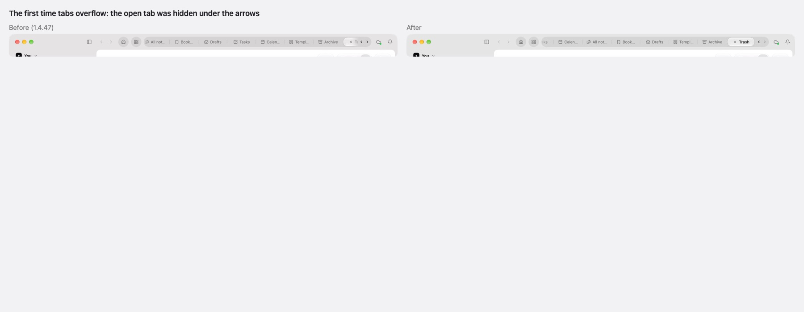
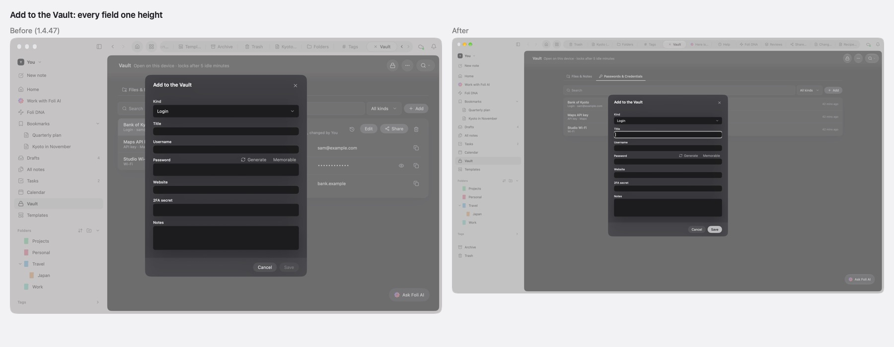
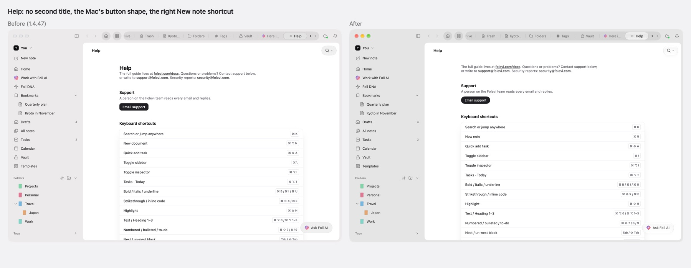
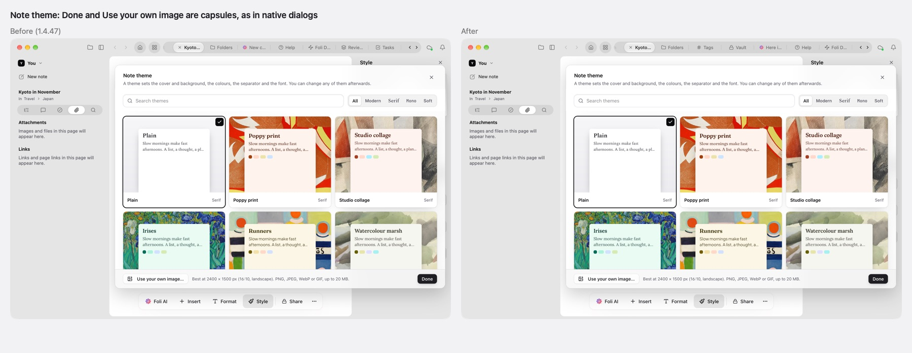

# Folevi for Mac: UI and function audit, 2026-11-18

Asked by the owner after 1.4.47: "there are still a lot of small UI issues, the spacing is uneven, text is pushing
too far left to the hover effect". Scope: the whole Mac app, on a scratch library (never the owner's library,
account or Keychain). Branch `mac-ui-audit`, from `main` at 1.4.47. Not released.

## How it was checked

- Every screen of the native frame, light and dark, as real window captures (`screens.mjs --look`): 47 screens,
  167 pictures, before and after. Popovers, menus, right-click menus, the Tab Overview, the smallest window.
- The note page (the one web part) with each panel and dialog open, with two automatic checks that must answer
  nothing: `hover-lint.js` (words against the edge of their own hover) and `font-lint.js` (interface text that isn't
  the system font).
- Functions on the scratch library: folders (create, nest, rename, colour, move, delete), notes (create, move,
  bookmark, duplicate, archive, trash, restore), tasks (create with a date and priority, complete, lists), tags,
  Foli AI on the stand-in model, the editor (bold, to-do, heading, card, page width, separator, colours, insert).
  All 35 steps pass (23 on the library, 12 in the editor; the script's Heading step looked for the wrong tag and was
  checked by hand: the line becomes a heading and goes back).
- Tests: 1,810 web unit tests, 209 Mac frame Swift tests, type-check and lint.

## What was wrong and is fixed

### The Style panel: rows no longer sit against their hover, even spacing, and the panel sits beside the note

### A note at a 1280 pt window: the panel covered the note's words, now it sits beside it

### The Format panel: Page and Card now look and behave like every other tile

### The first time tabs overflow: the open tab was hidden under the arrows

### Add to the Vault: every field one height

### Help: no second title, the Mac's button shape, the right New note shortcut

### Move folder: every row's name on one line

### Note theme: Done and Use your own image are capsules, as in native dialogs

### The smallest window: the tools' title in the system font

Also fixed, without a picture: the Import card in Settings had more padding under its buttons than above them; the
Vault's Add dialog took its height from whichever window was key, so it cut off its Notes field when Settings was
open or the app was behind another.

## Not covered, and why

- **Hover states of the native parts** (sidebar rows, cards, tabs) could not be pictured: moving the pointer for
  the test app alone isn't possible, and taking over the Mac's pointer wasn't acceptable while the owner worked.
  Web hovers (the note page) are measured by `hover-lint.js`.
- **Sync, sharing, comments, sign-in and real Foli AI answers** were not run. The scratch library is local, and
  no dev test account was signed in during this pass. They are covered only by the existing tests.
- **Drag and drop, printing, Quick Add from another app, Touch ID, updates** were not exercised.
- Twice the test window became screen-sized by itself during scripted runs. It didn't happen again in a dozen
  tries, and the existing scripts already work round it ("the size again for every screen"). Not found.

The rules these fixes follow are in `docs/MAC_NATIVE_LOOK.md` ("The note page follows the same rules").
